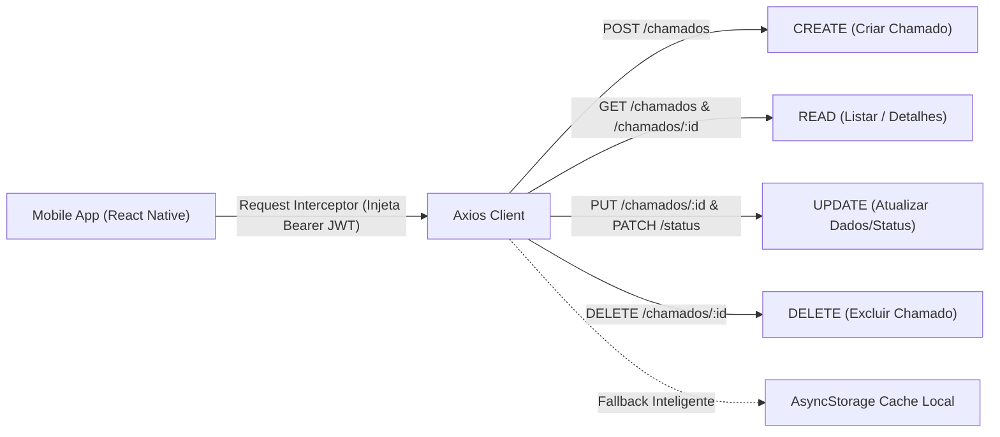

# CitizenTech - Zeladoria Urbana Colaborativa
### FIAP Global Solution 2026/2 • Mobile Application Development
> Aplicativo móvel para engajamento cidadão, registro de ocorrências urbanas, acompanhamento de reparos e transparência pública.

---

## 📌 1. Identificação do Projeto e Edital

* **Tema:** CitizenTech (Zeladoria Urbana Colaborativa & Cidades Inteligentes)
* **Alinhamento ODS:** ODS 11 – Cidades e Comunidades Sustentáveis (ONU)
* **Versão da Aplicação:** `1.0.0`
* **Commit Hash de Referência (Obrigatório conforme Edital):**
  ```text
  16e20b79da934cb48e22c9e782d47cb4e819b5bf
  ```
  *(Identificador curto de auditoria: `16e20b7`)*

---

## 👥 2. Integrantes do Grupo

| Nome Completo | RM | Turma | GitHub | LinkedIn |
| :--- | :---: | :---: | :--- | :--- |
| **Enzo Okuizumi** | **561432** | 2TDSPG | [@EnzoOkuizumiFiap](https://github.com/EnzoOkuizumiFiap) | [LinkedIn](https://www.linkedin.com/in/enzo-okuizumi-b60292256/) |
| **Gustavo Okada** | **563428** | 2TDSPG | [@Gdev3356](https://github.com/Gdev3356) | [LinkedIn](https://www.linkedin.com/in/gustavo-okada-53a3b8359/) |
| **Lucas Barros Gouveia** | **566422** | 2TDSPG | [@LuzBGouveia](https://github.com/LuzBGouveia) | [LinkedIn](https://www.linkedin.com/in/lucas-barros-gouveia-09b147355/) |
| **Luna de Carvalho Guimarães** | **562290** | 2TDSPG | [@lunaguima](https://github.com/lunaguima) | [LinkedIn](https://www.linkedin.com/in/luna-guimar%C3%A3es-b0ba82309/) |
| **Milton Marcelino** | **564836** | 2TDSPG | [@MiltonMarcelino](https://github.com/MiltonMarcelino) | [LinkedIn](https://www.linkedin.com/in/milton-marcelino-250298142) |

---

## 🚀 3. Visão Geral da Solução

O **CitizenTech** é uma plataforma móvel desenvolvida em **React Native com Expo e TypeScript**, desenhada para aproximar a população da gestão pública municipal. Por meio do aplicativo, cidadãos podem:
1. **Identificar e reportar problemas urbanos em tempo real:** Buracos na via, bueiros entupidos, iluminação pública apagada, entulho descartado irregularmente, podas emergenciais de árvores, entre outros.
2. **Geolocalização Precisa:** Inserção assistida de coordenadas GPS e endereço de referência para direcionar com precisão as equipes de zeladoria.
3. **Acompanhamento Transparente do Ciclo de Vida (CRUD):** Timeline auditável exibindo a evolução da solicitação (`Aberto` ➔ `Em Andamento` ➔ `Resolvido`).
4. **Resiliência e Continuidade Operacional:** Integração total via **Axios** com interceptores para injeção de **Bearer Token JWT**, somada a uma camada de **cache offline persistente** que garante a avaliação contínua do aplicativo mesmo sob instabilidades de rede ou servidores em manutenção.

---

## 📱 4. Mapeamento das Telas do Aplicativo

O projeto atende com rigor às exigências de tela do edital (mínimo de 6 telas funcionais + 1 tela extra obrigatória "Sobre o App" + tela auxiliar de apoio ao CRUD):

| # | Tela | Arquivo | Descrição Funcional |
| :---: | :--- | :--- | :--- |
| **1** | **Login** | [`src/screens/LoginScreen.tsx`](file:///c:/desenvolvimento/faculdade/GS/Mobile-Application-Development/src/screens/LoginScreen.tsx) | Validação de campos (e-mail e senha), estados de loading com `ActivityIndicator`, tratamento de erros, e botão de preenchimento automático para avaliadores FIAP. |
| **2** | **Cadastro / Signup** | [`src/screens/RegisterScreen.tsx`](file:///c:/desenvolvimento/faculdade/GS/Mobile-Application-Development/src/screens/RegisterScreen.tsx) | Formulário de adesão do cidadão com validação de Nome, E-mail, Senha, Confirmação, CPF, Telefone e Bairro residencial. |
| **3** | **Home / Feed do Bairro** | [`src/screens/HomeScreen.tsx`](file:///c:/desenvolvimento/faculdade/GS/Mobile-Application-Development/src/screens/HomeScreen.tsx) | Header de boas-vindas, cards de métricas (Total, Abertos, Em Ação, Resolvidos), barra de busca instantânea, chips horizontais de categorias, filtros por status e pull-to-refresh (`RefreshControl`). |
| **4** | **Novo Chamado** | [`src/screens/NovoChamadoScreen.tsx`](file:///c:/desenvolvimento/faculdade/GS/Mobile-Application-Development/src/screens/NovoChamadoScreen.tsx) | Registro de ocorrência com seletor de categorias com ícones, descrição detalhada, fotos simuladas da ocorrência e botão "Usar Minha Localização Atual (Região Paulista/FIAP)". |
| **5** | **Detalhes do Chamado** | [`src/screens/ChamadoDetailsScreen.tsx`](file:///c:/desenvolvimento/faculdade/GS/Mobile-Application-Development/src/screens/ChamadoDetailsScreen.tsx) | Exibição de dados completos, autor, protocolo, fotos, mapa com coordenadas, histórico temporal de status e ações de negócio (alteração de status com parecer técnico e exclusão segura). |
| **6** | **Perfil do Cidadão** | [`src/screens/ProfileScreen.tsx`](file:///c:/desenvolvimento/faculdade/GS/Mobile-Application-Development/src/screens/ProfileScreen.tsx) | Exibição dos dados do usuário logado, métricas pessoais de contribuição, listagem dos chamados abertos pelo próprio usuário, utilitário de reset do mock para testes e botão de Logout. |
| **Extra** | **Sobre o App** | [`src/screens/SobreAppScreen.tsx`](file:///c:/desenvolvimento/faculdade/GS/Mobile-Application-Development/src/screens/SobreAppScreen.tsx) | **Obrigatória:** Exibição da versão (1.0.0), integrantes do grupo com RM, alinhamento ODS 11 e o **campo explícito com o Commit Hash de referência** auditável. |
| **Apoio** | **Editar Chamado** | [`src/screens/EditarChamadoScreen.tsx`](file:///c:/desenvolvimento/faculdade/GS/Mobile-Application-Development/src/screens/EditarChamadoScreen.tsx) | Apoio à operação `UPDATE` do CRUD, permitindo editar título, descrição, categoria e endereço da ocorrência já existente. |

---

## 🏗️ 5. Arquitetura de Software (Clean Architecture)

A estrutura de pastas foi organizada segundo os princípios da Clean Architecture, garantindo modularidade, desacoplamento e testabilidade:

```text
/
├── assets/                  # Ícones adaptativos e splash screen
├── src/
│   ├── components/          # Componentes de UI reaproveitáveis
│   │   ├── Button.tsx       # Botão customizado (primary, secondary, outline, danger)
│   │   ├── Input.tsx        # Campo de entrada com label, ícones e toggle de senha
│   │   ├── ChamadoCard.tsx  # Card visual de ocorrência de zeladoria
│   │   ├── StatusBadge.tsx  # Badge semântico de status (Aberto/Em Andamento/Resolvido)
│   │   ├── CategoryBadge.tsx# Badge com ícone específico para cada categoria
│   │   ├── Header.tsx       # Cabeçalho padrão do app
│   │   ├── FeedbackModal.tsx# Modais de sucesso, erro e confirmação de ações
│   │   ├── StatCard.tsx     # Cartão métrico para indicadores
│   │   └── EmptyState.tsx   # Estado vazio elegante para listas e buscas
│   │
│   ├── contexts/            # Context API do React
│   │   └── AuthContext.tsx  # Gerenciador global de sessão, login, registro e logout
│   │
│   ├── hooks/               # Custom Hooks encapsulando regras de negócio
│   │   ├── useAuth.ts       # Hook de consumo seguro da autenticação
│   │   └── useChamados.ts   # Hook centralizador de operações CRUD e filtros
│   │
│   ├── navigation/          # Roteamento tipado com React Navigation
│   │   ├── types.ts         # Tipagem estrita de parâmetros das rotas
│   │   ├── AuthNavigator.tsx# Fluxo público (Login, Register)
│   │   ├── TabNavigator.tsx # Barra de navegação inferior (Feed, Relatar, Perfil, Sobre)
│   │   ├── AppNavigator.tsx # Stack interna protegida (Tabs, Detalhes, Editar)
│   │   └── index.tsx        # Gatekeeper de proteção de rotas (Token ? App : Auth)
│   │
│   ├── screens/             # Telas de negócio e extra da aplicação
│   │   ├── LoginScreen.tsx
│   │   ├── RegisterScreen.tsx
│   │   ├── HomeScreen.tsx
│   │   ├── NovoChamadoScreen.tsx
│   │   ├── ChamadoDetailsScreen.tsx
│   │   ├── EditarChamadoScreen.tsx
│   │   ├── ProfileScreen.tsx
│   │   └── SobreAppScreen.tsx
│   │
│   ├── services/            # Camada de comunicação com APIs e persistência
│   │   ├── api.ts           # Cliente Axios com interceptors de Bearer Token e erros
│   │   ├── authService.ts   # Autenticação e perfil com fallback resiliente
│   │   ├── chamadoService.ts# Implementação das operações CRUD completas
│   │   ├── storageService.ts# Abstração de armazenamento local seguro (AsyncStorage)
│   │   └── mockData.ts      # Dados representativos reais de São Paulo e conta demo
│   │
│   ├── theme/               # Sistema de Design do CitizenTech
│   │   ├── colors.ts        # Paleta Verde Esmeralda, Azul Ardósia e Cinzas Neutros
│   │   ├── spacing.ts       # Escala de espaçamentos, bordas e sombras
│   │   ├── typography.ts    # Escala tipográfica e pesos
│   │   └── index.ts         # Exportação unificada do tema
│   │
│   └── types/               # Tipagens TypeScript e entidades de domínio
│       └── index.ts         # Interfaces de Chamado, Usuário, Localização, Status, etc.
│
├── App.tsx                  # Ponto de entrada com SafeAreaProvider e AuthProvider
├── app.json                 # Manifesto do Expo
├── package.json             # Dependências e scripts
└── tsconfig.json            # Configuração do TypeScript com path mapping
```

---

## ⚡ 6. Integração CRUD e Consumo da API REST

A aplicação implementa integralmente os métodos HTTP do CRUD de chamados através da biblioteca **Axios**:



### Endpoints Mapeados:
* `POST /auth/login` – Autenticação com credenciais do cidadão
* `POST /auth/register` – Cadastro de novos cidadãos
* `GET /auth/me` – Recuperação dos dados do perfil autenticado
* `GET /chamados` – Leitura com suporte a filtros (`categoria`, `status`, `busca`, `apenasMeus`)
* `GET /chamados/:id` – Leitura detalhada por identificador único
* `POST /chamados` – Criação de nova ocorrência com localização e foto
* `PUT /chamados/:id` – Atualização cadastral de dados do chamado
* `PATCH /chamados/:id/status` – Atualização de status e inserção de parecer no histórico
* `DELETE /chamados/:id` – Exclusão permanente de ocorrência

### Interceptors Configurados no Axios:
1. **Request Interceptor:** Lê assincronamente o token JWT armazenado e injeta no cabeçalho `Authorization: Bearer <token>`.
2. **Response Interceptor:** Captura respostas 401 para acionar o logout automático por expiração de sessão e traduz erros 400/404/500 e falhas de rede em mensagens amigáveis aos usuários.

---

## 🎨 7. Identidade Visual (Design System)

Alinhado com o tema **CitizenTech**, a interface adota tons ecológicos e tecnológicos:
* 🟢 **Verde Esmeralda (`#059669`, `#10B981`):** Simboliza sustentabilidade, solução e avanço ecológico.
* 🔵 **Azul Ardósia (`#1E293B`, `#334155`):** Expressa seriedade, governança pública e tecnologia.
* ⚪ **Cinzas Neutros e Branco (`#F8FAFC`, `#FFFFFF`):** Proporcionam alto contraste e acessibilidade visual.
* 🟡 **Status Amigáveis:**
  * `Aberto`: Âmbar / Laranja
  * `Em Andamento`: Azul Técnico
  * `Resolvido`: Verde Esmeralda

---

## 💻 8. Como Executar o Projeto

### Pré-requisitos:
* **Node.js** (versão 20 ou superior recomendada)
* **npm** ou **yarn**
* Dispositivo móvel com o app **Expo Go** instalado (Android ou iOS) OU emulador configurado.

### Passo a Passo:

1. **Clonar ou acessar o repositório:**
   ```bash
   git clone https://github.com/Global-Solution-CitizenTech/Mobile-Application-Development.git
   cd Mobile-Application-Development
   ```

2. **Instalar as dependências do projeto:**
   ```bash
   npm install
   ```

3. **Iniciar o servidor de desenvolvimento do Expo:**
   ```bash
   npx expo start
   ```

4. **Executar no dispositivo:**
   * **No celular:** Abra o app **Expo Go** e leia o QR Code gerado no terminal.
   * **No Android Emulator:** Pressione a tecla `a` no terminal.
   * **Na Web:** Pressione a tecla `w` no terminal.

---

## 🔑 9. Credenciais para Teste Rápido do Avaliador FIAP

Para facilitar a correção e avaliação da banca examinadora, a tela de login conta com um botão dedicado **"Preencher Acesso Demo (Avaliador FIAP)"**, que preenche os campos com 1 clique:

* **E-mail:** `cidadao.fiap@citizentech.com.br`
* **Senha:** `123456`

*(Também é possível cadastrar qualquer novo usuário na tela de cadastro ou criar novos chamados à vontade! O botão "Restaurar Dados Padrão de Demonstração" no Perfil permite resetar as ocorrências ao estado original a qualquer momento).*

---

### Licença e Direitos
Desenvolvido exclusivamente para a **FIAP Global Solution 2026/2** sob a licença MIT.

